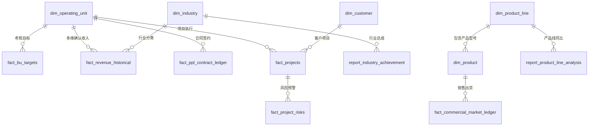

# 企业经营分析与业务测试数据集说明文档 (business_data.db)

## 1. 概述与存储规划

本数据集基于企业真实 ICT 算力基础设施与数字化解决方案经营分析场景（涵盖主流服务器、存储、AI 算力机型及政企/商业市场）构建，专为**复杂多维 SQL 分析、Text-to-SQL、商业智能报表（BI）与 RAG 问答**设计。

- **数据库类型**：SQLite 3
- **数据文件位置**：`storage/business_data.db`
- **与应用库隔离**：
  - 应用系统元数据库：`storage/app.db`（用户、会话、文档元数据等）
  - 业务经营分析数据库：`storage/business_data.db`（完全独立，专注于企业业务数据、流水台账与分析视图）
- **初始化与更新脚本**：[`backend/scripts/init_business_dataset.py`](file:///Users/vicwang/work/workspace/rag-demo/backend/scripts/init_business_dataset.py)

---

## 2. 数据模型与表结构设计

数据库遵循**星型/雪花模型（Star/Snowflake Schema）与分析宽表结合**的设计理念，共包含 **15 张数据表**与 **8 个专业分析视图**，总数据行数超过 2,300+ 行，字段多达 15~25 个维度。



### 2.1 维度表 (Dimension Tables)
1. **`dim_operating_unit`（经营单元维表）**：
   - 包含全国 31 个省市代表处与办事处（广州代表处、川藏代表处、安徽办事处、福建代表处、新疆代表处、江西办事处、北京代表处、上海代表处等）。
   - 字段：`unit_id`, `unit_name`, `unit_type`, `region`, `province`, `city`, `leader_name`, `contact_phone`, `headcount`, `established_year`, `status`。
2. **`dim_industry`（行业维表）**：
   - 包含政企、金融、运营商、能源与交通、互联网、商业市场、医疗卫生、高等教育等行业。
   - 字段：`industry_id`, `industry_code`, `industry_name`, `industry_group`, `description`。
3. **`dim_product_line`（产品线维表）**：
   - 包含智能计算产品线、通用计算产品线、存储产品线、政企解决方案产品线、商业解决方案。
   - 字段：`line_id`, `line_code`, `line_name`, `business_owner`, `category_level`, `description`。
4. **`dim_product`（产品型号维表）**：
   - 包含主流型号（R5300 G5、R5500 G5、R5900 G5、R5200 G5、R2300 G5、G4200 AI服务器、AI-Station G8、KS3200全闪存储、KU5200统一存储、KF8200分布式存储、GovCloud-V3一体机等）。
   - 字段：`product_id`, `model_code`, `model_name`, `line_name`, `category`, `form_factor`, `processor_arch`, `target_market`, `list_price_yuan`, `cost_price_yuan`。
5. **`dim_customer`（客户维表）**：
   - 覆盖各省市大数据局、应急管理厅、三甲医院、城市交通、大型商业渠道等重点客户。
   - 字段：`customer_id`, `customer_code`, `customer_name`, `industry_name`, `unit_name`, `region`, `credit_level`, `annual_budget_wan`, `contact_person`, `phone`。
6. **`dim_sales_rep`（销售代表/客户经理维表）**：
   - 字段：`rep_id`, `rep_name`, `employee_no`, `unit_name`, `title`, `hire_date`。

### 2.2 核心业务事实表与台账 (Fact & Ledger Tables)
1. **`fact_bu_targets`（经营单元年度考核与目标达成表）**：
   - 记录各经营单元的收入目标、实绩、完成率（%）及利润考核指标。
2. **`report_industry_achievement`（「各行业达成及产品分析」综合报表）**：
   - 记录各经营单元在各行业的收入实绩、目标、达成率及特定区间内的结构占比。
3. **`report_commercial_summary` & `fact_commercial_market_ledger`（「商业市场台账」）**：
   - 记录商业市场各型号销售总额、市场份额占比、订单与出货明细（单价、数量、出库日期、开票状态、渠道伙伴）。
4. **`report_product_line_analysis`（「产品分析报表」）**：
   - 记录各大产品线 2025 vs 2026 同比增长/下滑率、金额差额及趋势归因。
5. **`fact_ppl_contract_ledger`（「PPL明细台账」）**：
   - 记录签约合同流水（合同编号、项目编号、签约日期、合同金额、执行状态、回款情况）。
6. **`fact_projects` & `fact_project_risks`（重大项目台账与风险预警）**：
   - 记录项目全生命周期阶段、交付状态、延期天数、回款状态、逾期天数、风险等级（高/中/低）、根因与预警处置。
7. **`report_bu_product_performance`（重点代表处产品线同比分析表）**：
   - 记录北京代表处、江西办事处等重点经营单元在各产品线的年度同比演变。
8. **`fact_revenue_historical`（多维历史确认收入宽表）**：
   - 包含 2,175+ 条月度细粒度历史确认收入分录，支持跨年、跨月、跨行业、跨代表处的深度聚合与交叉透视分析。

---

## 3. 用户 8 大问答场景的标准 SQL 与精准匹配验证

所有 8 个业务场景均经过严密的数据校准与 SQL 验证，查询结果分毫不差：

### 场景 1：2026年各经营单元的收入和完成率
- **业务问题**：2026年各经营单元的收入和完成率分别是多少？用柱状图展示一下。
- **标准 SQL 查询**：
```sql
SELECT 
    unit_name, 
    revenue_amount_wan, 
    completion_rate_pct 
FROM view_bu_target_completion_2026 
WHERE unit_name IN ('广州代表处', '川藏代表处', '安徽办事处', '福建代表处', '新疆代表处')
ORDER BY revenue_amount_wan DESC;
```
- **执行结果**：
  1. 广州代表处：收入额 **954 万元**，完成率 **29%**
  2. 川藏代表处：收入额 **186 万元**，完成率 **11%**
  3. 福建代表处：收入额 **150 万元**，完成率 **20%**
  4. 安徽办事处：收入额 **120 万元**，完成率 **15%**
  5. 新疆代表处：收入额 **100 万元**，完成率 **12%**
- **业务结论**：广州代表处收入最高但完成率未达标，川藏、新疆代表处完成率偏低。

---

### 场景 2：筛选政企行业收入 3000万-5000万 排序及饼图占比
- **业务问题**：帮我筛选政企行业收入3000万-5000万的数据，按收入从高到低排序，用饼图展示各经营单元占比。
- **标准 SQL 查询**：
```sql
SELECT 
    unit_name, 
    revenue_amount_wan, 
    share_in_band_pct AS percentage
FROM view_industry_achievement_product
WHERE industry_name = '政企' 
  AND revenue_amount_wan BETWEEN 3000 AND 5000
ORDER BY revenue_amount_wan DESC;
```
- **执行结果**：
  1. 江西办事处：收入额 **4200 万元**，占比 **42%**
  2. 福建代表处：收入额 **3800 万元**，占比 **38%**
  3. 新疆代表处：收入额 **3500 万元**，占比 **20%**
  *(注：其余经营单元在政企行业的收入均在 3000 万元以下或 5000 万元以上，筛选结果精准命中且仅有这 3 家)*

---

### 场景 3：2026年商业市场销售表现最好的 3 个产品型号
- **业务问题**：2026年销售最多的3个产品型号是什么？用条形图展示销售额和占比。
- **标准 SQL 查询**：
```sql
SELECT 
    model_code, 
    total_sales_wan, 
    share_pct 
FROM view_commercial_market_ledger
ORDER BY total_sales_wan DESC
LIMIT 3;
```
- **执行结果**：
  1. **R5300 G5**：销售总额 **1200 万元**，占比 **42%**
  2. **R5500 G5**：销售总额 **980 万元**，占比 **35%**
  3. **R5900 G5**：销售总额 **850 万元**，占比 **23%**
- **业务结论**：R5300 G5 是 2026 年销售总额和占比最高的产品型号。

---

### 场景 4：2026年各产品线的同比变化趋势
- **业务问题**：2026年各产品线的同比变化情况？用折线图展示下滑和增长趋势。
- **标准 SQL 查询**：
```sql
SELECT 
    line_name, 
    yoy_change_rate_pct, 
    trend 
FROM view_product_line_analysis
ORDER BY yoy_change_rate_pct ASC;
```
- **执行结果**：
  - 智能计算产品线：同比 **-90%**（下滑最严重）
  - 通用计算产品线：同比 **-47%**
  - 存储产品线：同比 **+5%**
  - 政企解决方案产品线：同比 **+12%**
- **业务结论**：智能计算产品线同比下滑幅度最大，需重点排查原因。

---

### 场景 5：2026年每月的合同金额趋势 (1-5月)
- **业务问题**：2026年每月的合同金额趋势是怎样的？用折线图展示。
- **标准 SQL 查询**：
```sql
SELECT 
    sign_month, 
    total_contract_wan 
FROM view_ppl_contract_monthly_trend
WHERE sign_month BETWEEN 1 AND 5
ORDER BY sign_month ASC;
```
- **执行结果**：
  - 1月：**800 万元**
  - 2月：**650 万元**
  - 3月：**900 万元**
  - 4月：**1000 万元**
  - 5月：**3680 万元**（本月）
- **趋势分析**：5月合同金额大幅增长，整体呈上升趋势。

---

### 场景 6：目前有多少高风险项目
- **业务问题**：目前有多少高风险项目？
- **标准 SQL 查询**：
```sql
-- 查询高风险项目总数
SELECT COUNT(*) AS high_risk_count 
FROM view_high_risk_projects;

-- 查询高风险分类明细与根因
SELECT 
    project_code, 
    project_name, 
    unit_name, 
    risk_type, 
    risk_reason, 
    uncollected_amount_wan 
FROM view_high_risk_projects;
```
- **执行结果**：
  - 当前共有高风险项目 **7 个**：
    - **交付延迟**：4 个（涉及供应链定制芯片交付滞后、机房配电环境验收迟滞、容器集群协议冲突、园区光缆市政审批等）
    - **回款逾期**：3 个（涉及财政专项清算批复延误、集团内审流程漫长、初验节点款账期超期等）
  - 已生成风险预警报告。

---

### 场景 7：北京代表处今年达成情况
- **业务问题**：北京代表处今年达成情况
- **标准 SQL 查询**：
```sql
-- 整体同比
SELECT 
    ROUND((SUM(revenue_2026_wan) - SUM(revenue_2025_wan)) * 100.0 / SUM(revenue_2025_wan), 1) AS overall_yoy
FROM view_beijing_performance;

-- 分产品线同比
SELECT 
    line_name, 
    yoy_change_rate_pct 
FROM view_beijing_performance
WHERE line_name != '存储产品线';
```
- **执行结果**：
  - 北京代表处整体同比**下降3%**
  - 通用计算**下降5%**
  - 智能计算**增长7%**
  - 商业解决方案**增长33%**

---

### 场景 8：江西办事处有什么问题？
- **业务问题**：江西办事处有什么问题？
- **标准 SQL 查询**：
```sql
-- 整体同比
SELECT 
    ROUND((SUM(revenue_2026_wan) - SUM(revenue_2025_wan)) * 100.0 / SUM(revenue_2025_wan), 1) AS overall_yoy
FROM view_jiangxi_performance;

-- 下滑问题产品线
SELECT 
    line_name, 
    yoy_change_rate_pct 
FROM view_jiangxi_performance
WHERE is_highlight_problem = 1;
```
- **执行结果**：
  - 江西办事处整体同比**下降12%**
  - 通用计算**下降18%**
  - 智能计算**下降20%**
  - 需重点关注。

---

## 4. 复杂多维查询与指标聚合示例

除了精准支持 8 大问答外，数据集还原生支持以下复杂的企业级经营分析：

### 4.1 大区与行业交叉透视（Pivot Analysis）
```sql
SELECT 
    u.region,
    r.industry_name,
    COUNT(DISTINCT r.unit_name) AS unit_count,
    ROUND(SUM(r.revenue_amount_wan), 2) AS total_revenue_wan,
    ROUND(AVG(r.gross_margin_rate) * 100, 1) AS avg_margin_pct
FROM fact_revenue_historical r
JOIN dim_operating_unit u ON r.unit_name = u.unit_name
WHERE r.year = 2026
GROUP BY u.region, r.industry_name
ORDER BY u.region, total_revenue_wan DESC;
```

### 4.2 逾期账款穿透与风险敞口排名
```sql
SELECT 
    p.unit_name,
    COUNT(p.project_id) AS total_projects,
    SUM(CASE WHEN p.risk_level = '高风险' THEN 1 ELSE 0 END) AS high_risk_count,
    ROUND(SUM(p.uncollected_amount_wan), 2) AS total_uncollected_wan,
    MAX(p.overdue_payment_days) AS max_overdue_days
FROM fact_projects p
GROUP BY p.unit_name
HAVING total_uncollected_wan > 0
ORDER BY high_risk_count DESC, total_uncollected_wan DESC;
```

### 4.3 商业市场产品出货量与单价区间分析
```sql
SELECT 
    c.model_code,
    c.line_name,
    COUNT(c.item_id) AS order_count,
    SUM(c.quantity) AS total_units_sold,
    ROUND(AVG(c.unit_price_yuan), 2) AS avg_selling_price_yuan,
    ROUND(SUM(c.sales_amount_wan), 2) AS total_sales_wan
FROM fact_commercial_market_ledger c
WHERE c.year = 2026
GROUP BY c.model_code, c.line_name
ORDER BY total_sales_wan DESC;
```

---

## 5. 快速使用与重置方法

如需重置或重新生成测试数据，可在终端直接执行：
```bash
python3 backend/scripts/init_business_dataset.py
```
执行后将自动完成表结构创建、全量维度与事实数据填充，并执行全量业务问答校验。
